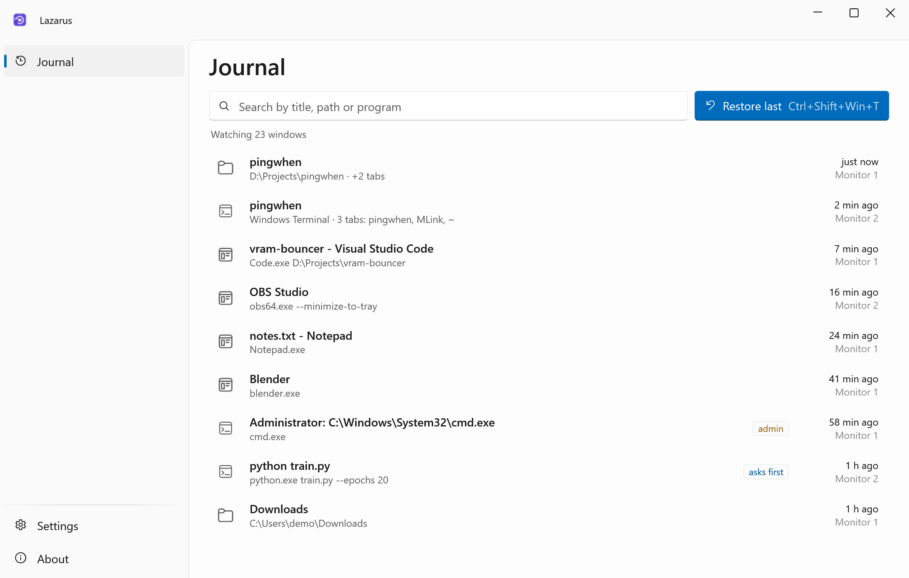
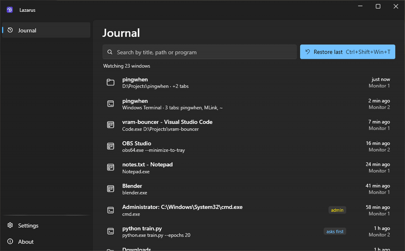
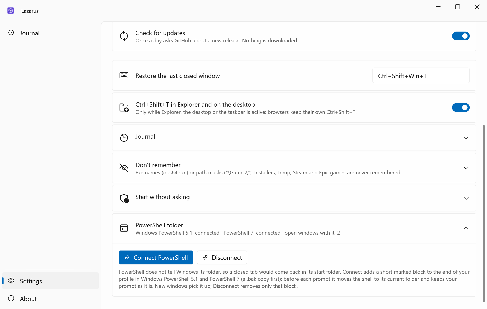
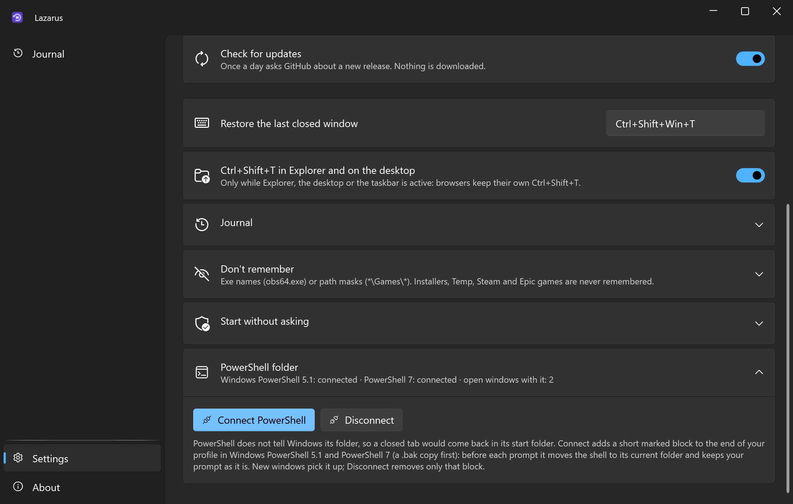
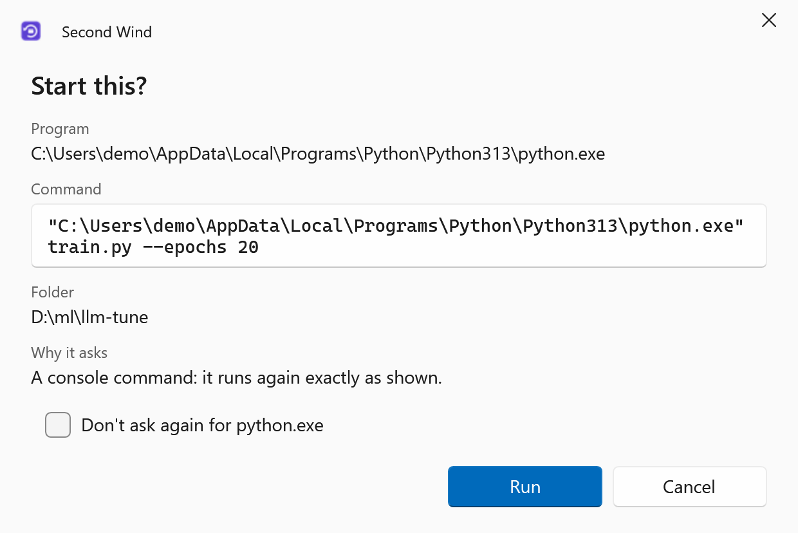
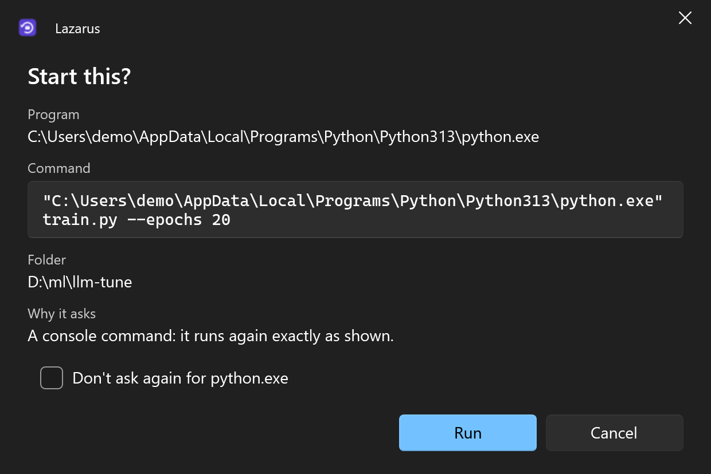

<div align="center">


# Lazarus

**Ctrl+Shift+T for your whole desktop: bring back the folder, terminal or app you just closed, right where it was.**

**English** · [Русский](README.ru.md)

[](https://github.com/lojekq/Lazarus/releases/latest)
[](https://github.com/lojekq/Lazarus/releases)
[](https://github.com/lojekq/Lazarus/actions/workflows/ci.yml)

[](LICENSE)

<picture>
  <source media="(prefers-color-scheme: dark)" srcset="docs/main-dark-en.png">
  
</picture>
</div>

## Why

You close an Explorer window with five folders deep, or a Windows Terminal with three tabs in three projects, and a second later you need it back.
Browsers have Ctrl+Shift+T for that; Windows does not. Lazarus adds it: one key brings the window back to the same folder, tabs, monitor and size.

## Features

- **One key** — `Ctrl+Shift+Win+T` brings back the last closed window, each next press the one before it. `Ctrl+Shift+T` works too while Explorer, the desktop or the taskbar is in front.
- **Explorer windows with their tabs** — the same folders, special ones like This PC included, as tabs of one window on the same spot of the same monitor. A single closed tab goes back into its window.
- **Windows Terminal with all its tabs** — every tab comes back with its profile and working folder.
- **Everything at once** — when Explorer restarts or three windows close within two seconds, one press brings them all back.
- **Apps in place** — programs return to the same monitor, size and position, even those that don't remember it themselves.
- **Safe** — commands typed in a terminal are never run again, and anything risky (console commands, admin windows, links or tokens in arguments) asks first.
- **Local** — no admin rights, no telemetry; the journal stays in `%APPDATA%\Lazarus`.

## See it in action



## Screenshots

| | Light | Dark |
|---|---|---|
| Settings |  |  |
| Asks first |  |  |

## How it works

Once a window is closed, Windows forgets its folder, its tabs and the command that started it: there is nothing left to ask. So Lazarus looks at open windows once a second and keeps a note for each: the program and its command line, position and monitor, Explorer's tab paths, and for every Terminal tab its profile and folder.
When a window disappears and its program really exits (not just hides in the tray), the note becomes a journal entry. The hotkey starts the program again with the same arguments and puts its new window where the old one was.
Lazarus brings back windows, not what was inside them: the tabs of your browser or an SSH session are the program's own business. A shell comes back in its folder; the commands you ran in it are not repeated.

**PowerShell folder.** `cd` in PowerShell doesn't change the folder Windows sees, so a PowerShell tab would come back in its start folder.
Press **Settings → PowerShell folder → Connect PowerShell** once. Lazarus adds a short marked block to the end of your profile in Windows PowerShell 5.1 and PowerShell 7 (a `.bak` copy first): before each prompt it moves the shell to its current folder and keeps your prompt as it is.
New windows pick it up. **Disconnect**, and uninstalling Lazarus, remove only that block. A PowerShell whose execution policy doesn't load profiles (Restricted, AllSigned) is left alone, and the settings say why.

## Download

1. **[Download Lazarus.exe](https://github.com/lojekq/Lazarus/releases/latest/download/Lazarus.exe)** (latest release). Single file, no admin rights.
2. Smaller build: [`Lazarus-fd.zip`](https://github.com/lojekq/Lazarus/releases/latest/download/Lazarus-fd.zip) (needs [.NET Desktop Runtime 10](https://dotnet.microsoft.com/download/dotnet/10.0)).
3. Optional check: `gh attestation verify <file> -R lojekq/Lazarus` or compare with `SHA256SUMS.txt`.

Requirements: Windows 11 x64. Windows 10 22H2 should work but is not tested.

## First run

Run the downloaded exe from anywhere. Windows may first show a SmartScreen warning (see FAQ).
Lazarus offers to install itself: **Install** copies it to `%LOCALAPPDATA%\Programs\Lazarus\` and adds a Start menu shortcut, autostart (it can only bring back windows it saw open) and an entry in Settings → Apps; no admin rights needed.
**Run without installing** keeps it portable. To update, run the new exe the same way: it replaces the installed one and restarts it.

## Settings

| Setting | Default | What it does |
|---|---|---|
| Restore the last closed window | `Ctrl+Shift+Win+T` | The global hotkey; "taken by another program" shows if it's busy |
| Ctrl+Shift+T in Explorer and on the desktop | on | Only while Explorer, the desktop or the taskbar is in front, so browsers keep theirs |
| Entries / days to keep | 30 / 7 | Size and age limit of the journal |
| Keep the journal between restarts | on | Off: the journal lives in memory only |
| Don't remember | empty | Exe names or path masks, on top of the built-in list (installers, Temp, Steam and Epic games) |
| Start without asking | empty | Programs you ticked "Don't ask again" for |
| Start with Windows, Start menu shortcut | on after installing | Starts minimized to the tray |
| Installation | — | Install, or Uninstall for the installed copy |
| Language, theme, check for updates | | As in every app of the set |

Settings, the journal and logs live in `%APPDATA%\Lazarus`.

## FAQ

<details><summary>Windows protected your PC / SmartScreen warning</summary>

The exe is not code-signed yet, so Windows does not know the publisher. Click **More info → Run anyway**.
Every file is built by GitHub Actions from this repository; you can check it with `gh attestation verify` or `SHA256SUMS.txt`.
Smart App Control, if it is on, blocks unsigned files with no way to allow one; the only option is to turn it off.
</details>

<details><summary>My antivirus flags it</summary>

Lazarus lists windows and processes, reads the folder of shell processes (cmd, pwsh, bash) from their memory, registers a global hotkey and starts programs: that can look like spyware to a heuristic.
There are no keyboard hooks, no code injection and no network beyond the update check; the code is all here. Please report the false positive to your antivirus vendor and open an issue with the detection name and the SHA256 of the file.
</details>

<details><summary>I closed a program and it is not in the journal</summary>

An entry appears only when the program actually exits within 15 seconds. Programs that go to the tray (Telegram, Discord) or keep another window open are still running, so there is nothing to bring back.
Windows that lived less than 3 seconds, installers, games and programs from your "Don't remember" list are skipped too.
</details>

<details><summary>Does it work with games and anti-cheat?</summary>

Games in any Steam library (`*\steamapps\common\*`) and in `*\Epic Games\*` are excluded: Lazarus reads only their path and opens nothing else. Add a game in another folder to "Don't remember".
The global hotkey has three modifiers, and `Ctrl+Shift+T` only works with Explorer, the desktop or the taskbar in front, so a game never loses focus by accident.
</details>

<details><summary>What about admin windows, WSL and virtual desktops?</summary>

A window that ran as administrator comes back only after you confirm, through the UAC prompt, and Windows does not let Lazarus move it.
A WSL tab opens in its profile's folder (a Linux path is out of reach from Windows). Windows open on the current virtual desktop.
A Terminal tab that a console program opened by itself (started outside Terminal and handed over to it) can't be told apart from other consoles and is not remembered.
PowerShell tabs, 5.1 and 7, come back in the right folder once PowerShell is connected in Settings.
</details>

<details><summary>How do I uninstall?</summary>

Settings → **Uninstall**, or Windows Settings → Apps → Lazarus → Uninstall. You choose whether settings, the journal and logs go too.
Without installing: About → **Remove data and autostart**, then delete the exe.
</details>

## Privacy

No telemetry. The only network request is the update check: `GET https://api.github.com/repos/lojekq/Lazarus/releases/latest` once a day; turn it off in Settings.
The journal (window titles, paths, command lines) stays on this PC in `%APPDATA%\Lazarus\journal.json`; turn off "Keep the journal between restarts" to keep it in memory only, or clear it.
InPrivate and incognito windows are saved under the program name, not their title. Logs contain no window titles, paths or command lines.

## Build from source

```powershell
winget install Microsoft.DotNet.SDK.10
git clone https://github.com/lojekq/Lazarus
cd Lazarus
dotnet run --project src/Lazarus
dotnet test
```

## License

MIT © 2026 lojekq
