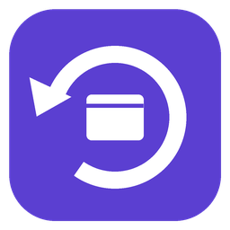
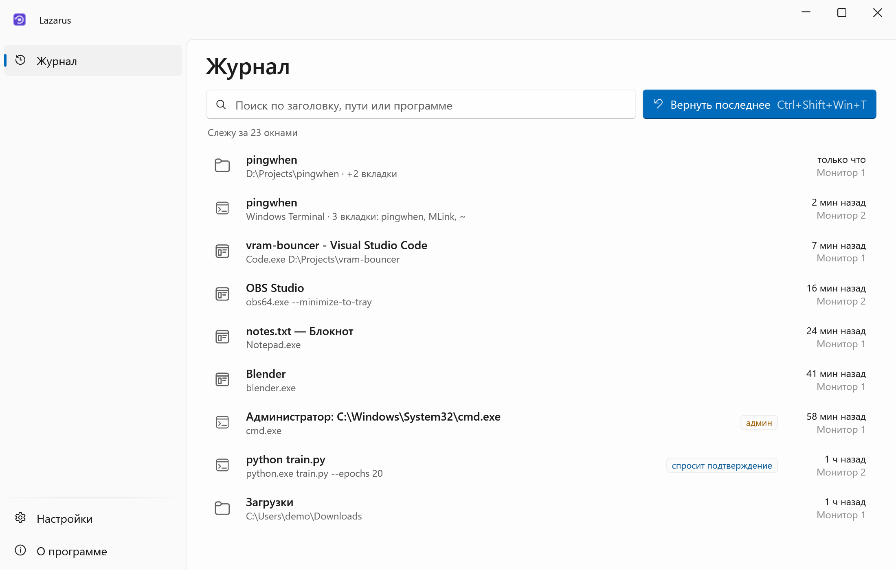
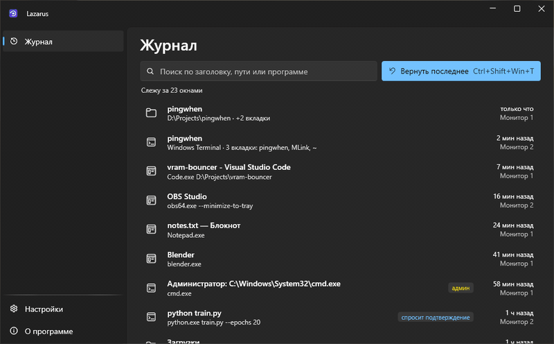
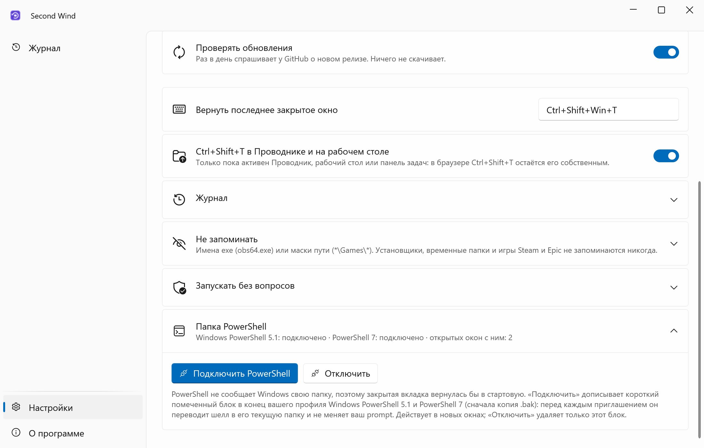
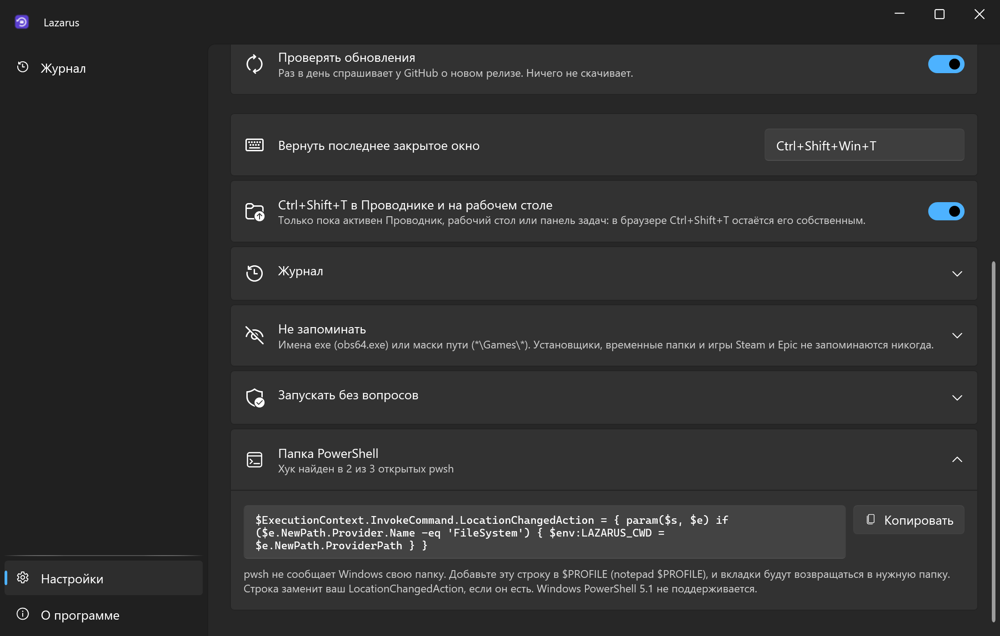
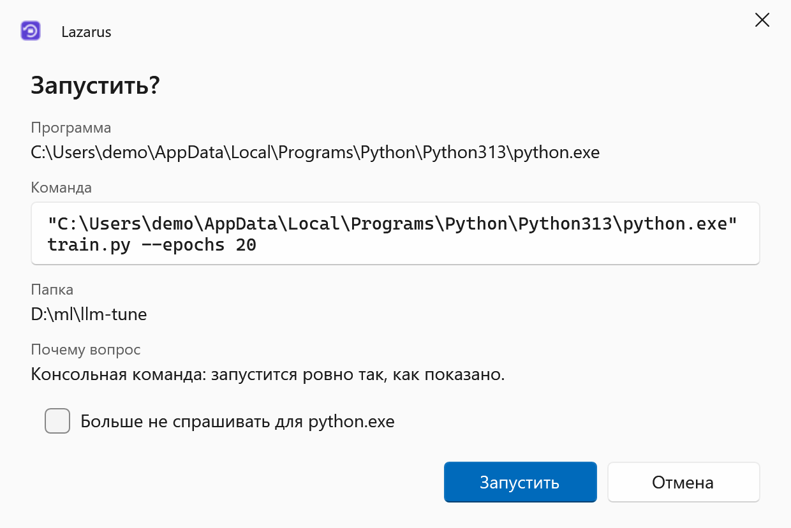
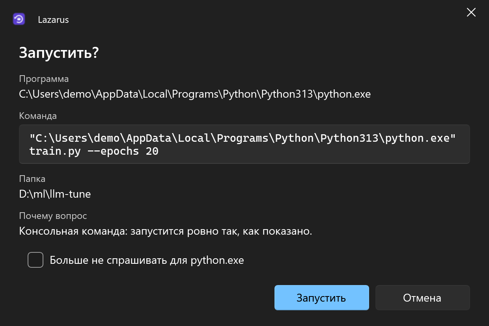

<div align="center">


# Second Wind

**Ctrl+Shift+T для всего рабочего стола: случайно закрытая папка, терминал или программа возвращаются туда же, где были.**

[English](README.md) · **Русский**

[](https://github.com/lojekq/SecondWind/releases/latest)
[](https://github.com/lojekq/SecondWind/releases)
[](https://github.com/lojekq/SecondWind/actions/workflows/ci.yml)

[](LICENSE)

<picture>
  <source media="(prefers-color-scheme: dark)" srcset="docs/main-dark-ru.png">
  
</picture>
</div>

## Зачем

Закрыли окно Проводника, где были на пятом уровне вложенности, или Windows Terminal с тремя вкладками в трёх проектах, а через секунду оно снова нужно.
В браузере для этого есть Ctrl+Shift+T, в Windows нет. Second Wind его добавляет: одна клавиша возвращает окно в ту же папку, с теми же вкладками, на тот же монитор и того же размера.

## Возможности

- **Одна клавиша** — `Ctrl+Shift+Win+T` возвращает последнее закрытое окно, каждое следующее нажатие — предыдущее. `Ctrl+Shift+T` тоже работает, пока активен Проводник, рабочий стол или панель задач.
- **Окна Проводника со вкладками** — те же папки, включая особые вроде «Этот компьютер», вкладками одного окна на том же месте того же монитора. Закрытая вкладка возвращается в своё окно.
- **Windows Terminal со всеми вкладками** — каждая вкладка возвращается со своим профилем и рабочей папкой.
- **Всё сразу** — если перезапустился Проводник или за две секунды закрылись три окна, одно нажатие возвращает их все.
- **Программы на своём месте** — возвращаются на тот же монитор, того же размера и в то же положение, даже если сами этого не умеют.
- **Безопасно** — команды, набранные в терминале, не повторяются, а всё рискованное (консольные команды, окна «от администратора», ссылки и токены в аргументах) запускается только после подтверждения.
- **Локально** — без прав администратора и телеметрии; журнал лежит в `%APPDATA%\SecondWind`.

## Как это выглядит



## Скриншоты

| | Светлая | Тёмная |
|---|---|---|
| Настройки |  |  |
| Подтверждение |  |  |

## Как это работает

После закрытия окна Windows забывает его папку, вкладки и команду, которой оно было запущено: спросить уже не у кого. Поэтому Second Wind раз в секунду смотрит на открытые окна и держит по каждому заметку: программа и её командная строка, положение и монитор, пути вкладок Проводника, профиль и папка каждой вкладки терминала.
Когда окно исчезает и его программа действительно завершается (а не прячется в трей), заметка становится записью журнала. Горячая клавиша запускает программу снова с теми же аргументами и ставит новое окно туда, где было старое.
Second Wind возвращает окна, а не то, что было внутри: вкладки браузера или SSH-сессия — дело самой программы. Шелл возвращается в свою папку, но команды, которые в нём выполнялись, не повторяются.

**Папка PowerShell.** `cd` в PowerShell не меняет папку, которую видит Windows, поэтому вкладка PowerShell вернулась бы в стартовую папку.
Один раз нажмите **Настройки → Папка PowerShell → Подключить PowerShell**. Second Wind допишет короткий помеченный блок в конец вашего профиля Windows PowerShell 5.1 и PowerShell 7 (сначала копия `.bak`): перед каждым приглашением он переводит шелл в его текущую папку и не меняет ваш prompt.
Действует в новых окнах. **«Отключить»** и удаление Second Wind убирают только этот блок. PowerShell с политикой выполнения, которая не загружает профили (Restricted, AllSigned), Second Wind не трогает и объясняет почему в настройках.

## Скачать

1. **[Скачать SecondWind.exe](https://github.com/lojekq/SecondWind/releases/latest/download/SecondWind.exe)** (последний релиз). Один файл, без прав администратора.
2. Сборка поменьше: [`SecondWind-fd.zip`](https://github.com/lojekq/SecondWind/releases/latest/download/SecondWind-fd.zip) (нужен [.NET Desktop Runtime 10](https://dotnet.microsoft.com/download/dotnet/10.0)).
3. Проверка по желанию: `gh attestation verify <файл> -R lojekq/SecondWind` или сверка с `SHA256SUMS.txt`.

Требования: Windows 11 x64. Windows 10 22H2 должна работать, но не тестируется.

## Первый запуск

Запустите скачанный exe откуда угодно. Сначала Windows может показать предупреждение SmartScreen (см. «Вопросы»).
Second Wind предложит установиться: **«Установить»** копирует его в `%LOCALAPPDATA%\Programs\SecondWind\` и добавляет ярлык в «Пуске», автозапуск (вернуть можно только окно, которое он видел открытым) и запись в «Параметры → Приложения»; права администратора не нужны.
**«Без установки»** оставляет его портативным. Обновление: запустите новый exe так же, он заменит установленный и перезапустит его.

## Настройки

| Настройка | По умолчанию | Что делает |
|---|---|---|
| Вернуть последнее закрытое окно | `Ctrl+Shift+Win+T` | глобальная горячая клавиша; если занята, рядом надпись «занято другой программой» |
| Ctrl+Shift+T в Проводнике и на рабочем столе | вкл. | только пока активен Проводник, рабочий стол или панель задач, так что в браузере сочетание остаётся его собственным |
| Записей / хранить, дней | 30 / 7 | размер журнала и срок хранения |
| Сохранять журнал между перезапусками | вкл. | выключено: журнал живёт только в памяти |
| Не запоминать | пусто | имена exe или маски пути, вдобавок к встроенному списку (установщики, временные папки, игры Steam и Epic) |
| Запускать без вопросов | пусто | программы, для которых отмечено «Больше не спрашивать» |
| Запускать вместе с Windows, ярлык в «Пуске» | вкл. после установки | стартует свёрнутым в трей |
| Установка | — | «Установить», а у установленного — «Удалить» |
| Язык, тема, проверка обновлений | | как во всех программах набора |

Настройки, журнал и логи лежат в `%APPDATA%\SecondWind`.

## Вопросы

<details><summary>«Система Windows защитила ваш компьютер» / предупреждение SmartScreen</summary>

Exe пока без цифровой подписи, поэтому Windows не знает издателя. Нажмите **«Подробнее» → «Выполнить в любом случае»**.
Каждый файл собирает GitHub Actions из этого репозитория; проверить его можно через `gh attestation verify` или `SHA256SUMS.txt`.
Если включён Smart App Control, он блокирует неподписанные файлы без возможности разрешить один; остаётся только выключить его.
</details>

<details><summary>Антивирус ругается на программу</summary>

Second Wind перечисляет окна и процессы, читает из памяти шеллов (cmd, pwsh, bash) их текущую папку, регистрирует глобальную горячую клавишу и запускает программы: эвристике это может напомнить шпиона.
Перехвата клавиатуры, внедрения в чужие процессы и сетевых запросов, кроме проверки обновлений, нет; весь код здесь. Отправьте ложное срабатывание производителю антивируса и откройте issue с названием угрозы и SHA256 файла.
</details>

<details><summary>Закрыл программу, а в журнале её нет</summary>

Запись появляется, только если программа действительно завершилась в течение 15 секунд. Программы, которые уходят в трей (Telegram, Discord) или держат другое окно открытым, продолжают работать, и возвращать нечего.
Ещё пропускаются окна, прожившие меньше 3 секунд, установщики, игры и программы из списка «Не запоминать».
</details>

<details><summary>Как с играми и античитом?</summary>

Игры из любой библиотеки Steam (`*\steamapps\common\*`) и из `*\Epic Games\*` исключены: Second Wind узнаёт только их путь и больше ничего у них не открывает. Игру в другой папке добавьте в «Не запоминать».
В глобальной клавише три модификатора, а `Ctrl+Shift+T` работает только при активном Проводнике, рабочем столе или панели задач, так что игра не потеряет фокус случайно.
</details>

<details><summary>А окна «от администратора», WSL и виртуальные рабочие столы?</summary>

Окно «от администратора» возвращается только после подтверждения и через запрос UAC, а передвинуть его Windows не даёт.
Вкладка WSL открывается в папке своего профиля: Linux-путь из Windows недоступен. Окна открываются на текущем виртуальном рабочем столе.
Вкладку Terminal, которую консольная программа открыла сама (запущена вне Terminal и передана ему), нельзя отличить от других консолей, и она не запоминается.
Вкладки PowerShell 5.1 и 7 возвращаются в нужную папку, когда PowerShell подключён в настройках.
</details>

<details><summary>Как удалить программу?</summary>

«Настройки» → **«Удалить»** или «Параметры Windows» → «Приложения» → Second Wind → «Удалить». Настройки, журнал и логи удаляются по вашему выбору.
Без установки: «О программе» → **«Удалить данные и автозапуск»**, затем удалите exe.
</details>

## Приватность

Телеметрии нет. Единственный сетевой запрос — проверка обновлений: `GET https://api.github.com/repos/lojekq/SecondWind/releases/latest` раз в день; выключается в настройках.
Журнал (заголовки окон, пути, командные строки) хранится только на этом ПК, в `%APPDATA%\SecondWind\journal.json`; можно выключить «Сохранять журнал между перезапусками» или очистить его.
Окна InPrivate и инкогнито сохраняются под именем программы, без заголовка. В логах нет заголовков окон, путей и командных строк.

## Сборка из исходников

```powershell
winget install Microsoft.DotNet.SDK.10
git clone https://github.com/lojekq/SecondWind
cd SecondWind
dotnet run --project src/SecondWind
dotnet test
```

## Лицензия

MIT © 2026 lojekq
